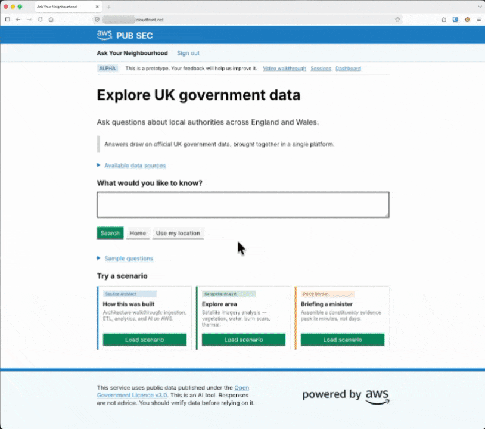

# Government Data Platform with AI Agents

UK government data is published by many departments, in many formats, on many sites. This repository is a working example of how to bring it into one place and ask questions through natural language. The data lands in a lakehouse built from Amazon S3, AWS Glue, Amazon S3 Tables and Amazon Redshift Serverless. AI agents on Amazon Bedrock AgentCore turn each question into SQL against that lakehouse. A web app built with the GOV.UK Design System sits in front of them.



> [!WARNING]
> The deployment changes two account-wide settings. They affect other workloads in the same account and Region. Check them before deploying into a shared account:
> - Step 4 adds the pipeline apply role to the account's Lake Formation admin list.
> - The pipeline turns on CloudWatch Transaction Search. X-Ray then stores every app's traces in CloudWatch Logs for the whole Region.

## Prerequisites

- [Terraform](https://developer.hashicorp.com/terraform/install) 1.14+
- [AWS CLI](https://docs.aws.amazon.com/cli/latest/userguide/getting-started-install.html) v2
- [Git](https://git-scm.com/downloads)
- An AWS account with an AWS CLI profile that has admin access
- A free [DWP Stat-Xplore API key](https://stat-xplore.dwp.gov.uk/)
- VPC Block Public Access off in the deploy region

## Deployment

The infrastructure is defined in Terraform and split across two root modules. The first, `bootstrap/`, is applied once from a local machine and creates the deployment pipeline. The second, `deploy/terraform-live/`, defines the platform itself. The pipeline applies it on every push to the source repository.

### Configuration

#### bootstrap/terraform.tfvars

These control how the deploy pipeline is built. Edit them before deploying (steps 2 and 3).

| Variable | Default | What it does |
|---|---|---|
| `prefix_code` | `govdata` | 1 to 10 lowercase characters, prefixed to every resource name |
| `aws_region` | `eu-west-2` | Region to deploy into |
| `codecommit_branch` | `main` | CodeCommit branch the pipeline deploys from |

#### deploy/terraform-live/terraform.tfvars

These set the platform's models and runtime options. The pipeline reads them on every run.

| Variable | Default | What it does |
|---|---|---|
| `AvailabilityZones` | `["eu-west-2a", "eu-west-2b"]` | The two zones the VPC subnets use. Change with the region |
| `BedrockModelSmart` | `eu.anthropic.claude-sonnet-4-6` | Model for complex questions (System 2) |
| `BedrockModelFast` | `eu.anthropic.claude-haiku-4-5-20251001-v1:0` | Model for simple questions (System 1) |
| `RedshiftWarmupEnabled` | `false` | Keeps Redshift awake 08:00 to 18:00 UTC on weekdays. Without it, the first question of the day waits for Redshift to start. Adds cost |
| `BedrockGuardrailEnabled` | `true` | Enforces Amazon Bedrock Guardrails on the data and geospatial agents |

`PrefixCode` and `Region` are in the file for reference. The pipeline overwrites them with the bootstrap values.

### 1. Clone and set credentials

```bash
git clone https://github.com/aws-samples/sample-code-for-government-data-platform-with-ai-agents-on-aws.git
cd sample-code-for-government-data-platform-with-ai-agents-on-aws
export AWS_PROFILE=<your-aws-profile>
```

### 2. Set the region and models

The defaults in `deploy/terraform-live/terraform.tfvars` are for `eu-west-2`. The model IDs are `eu.` cross-region inference profiles. Bedrock routes each request to any EU region with capacity, including regions outside the UK, and data stays within the EU.

To deploy elsewhere, for example `us-east-1`, change both model IDs to their `us.` equivalents and set `AvailabilityZones` to two zones in that region, such as `["us-east-1a", "us-east-1b"]`.

Check that both Claude models are authorised in the account and region:

```bash
aws bedrock get-foundation-model-availability --model-id anthropic.claude-sonnet-4-6 \
  --region eu-west-2 --query authorizationStatus
```

### 3. Set the prefix and region for bootstrap

Edit `bootstrap/terraform.tfvars`:

```hcl
prefix_code = "govdata"
aws_region  = "eu-west-2"
```

The prefix is 1 to 10 lowercase characters. It goes on the front of every resource name.

### 4. Run bootstrap

VPC Block Public Access must be disabled in the region. When enabled, it drops internet traffic to the web app's load balancer and the site times out. Check the current setting with:

```bash
aws ec2 describe-vpc-block-public-access-options --region eu-west-2 --query VpcBlockPublicAccessOptions.InternetGatewayBlockMode
```

Run bootstrap:

```bash
cd bootstrap
terraform init
terraform apply
```

Bootstrap creates:
- Terraform state bucket and KMS key
- Artifact S3 bucket
- CodePipeline, apply CodeBuild project and roles
- An empty CodeCommit repo, and an EventBridge rule that starts the pipeline on a push to `codecommit_branch`

Next, make the pipeline apply role a Lake Formation admin. Redshift reads the gold tables through Lake Formation, and the pipeline needs admin rights to grant that access. This command adds the role to the current admin list and leaves every other setting as it is:

```bash
ROLE=arn:aws:iam::$(aws sts get-caller-identity --query Account --output text):role/govdata-iamrole-pipeline-apply
aws lakeformation put-data-lake-settings --region eu-west-2 --data-lake-settings "$(aws lakeformation get-data-lake-settings --region eu-west-2 \
  --query "merge(DataLakeSettings, {DataLakeAdmins: [DataLakeSettings.DataLakeAdmins[?DataLakePrincipalIdentifier != '$ROLE'], [{DataLakePrincipalIdentifier: '$ROLE'}]] | []})")"
```

Git needs CodeCommit credentials. Install the AWS CLI credential helper once:

```bash
git config --global credential.helper '!aws codecommit credential-helper $@'
git config --global credential.UseHttpPath true
```

Add the repo as a git remote and push. This starts the first deploy:

```bash
git remote add deploy $(terraform output -raw codecommit_clone_url_http)
git push deploy main
```

### 5. Watch the pipeline

The push starts the pipeline. Follow its progress at the `pipeline_console_url` that bootstrap printed. The pipeline has five stages.

| Stage | What it does | On failure |
|---|---|---|
| Source | Pulls the pushed commit from CodeCommit | Stops |
| Validate | Runs tflint, `terraform fmt` and `terraform validate` | Stops |
| Build | Runs `terraform apply` on `deploy/terraform-live`, then builds five container images in parallel (agent, walkthrough, geospatial, webapp, dashboard) | The apply is allowed to fail. On a fresh account the agent runtimes point at images that don't exist yet |
| Deploy | Runs `terraform apply` again with the new image tags | Stops |
| Test | Runs the browser smoke test, `tests/browser_smoke_test.py --audit` | Allowed to fail |

A pipeline run takes about 10 minutes.

### 6. Create a sign-in

The web app starts with no users. Create one per person. Cognito emails each person a temporary password.

```bash
POOL_ID=$(aws cognito-idp list-user-pools --max-results 60 --query "UserPools[?Name=='govdata-cognito-webapp'].Id" --output text)
aws cognito-idp admin-create-user --user-pool-id $POOL_ID --username <user@example.com> --user-attributes Name=email,Value=<user@example.com> Name=email_verified,Value=true
```

The person signs in at the web app's CloudFront URL. Find it in the CloudFront console, or run `aws cloudfront list-distributions --query "DistributionList.Items[].DomainName"`.

### 7. Load the data

Four data sources need the DWP Stat-Xplore API key from the prerequisites, and the area profiles depend on those four. Store the key in Secrets Manager:

```bash
aws secretsmanager put-secret-value --secret-id govdata-api-keys-public --secret-string '{"dwp_stat_xplore": "<key>"}' --region eu-west-2
```

Then follow the [post-deploy guide](docs/post-deploy-guide.md) to ingest the data and run the ETL.

### 8. Make changes

Edit, commit, `git push deploy main`. The pipeline runs on every push.

The pipeline is triggered by pushes to CodeCommit. Teams that keep their code on GitHub, GitLab or another git host have two options: add a step to their existing CI that pushes the branch to the CodeCommit remote, or replace the pipeline in `bootstrap/pipeline.tf` with the equivalent on their own CI/CD platform.

## Project structure

```
├── .kiro/                    # Kiro steering and an MCP config template for the gateway
├── bootstrap/                # One-time account setup + the CodePipeline that deploys the platform
├── deploy/
│   ├── agent-geospatial/     # Satellite analysis agent container (AgentCore Runtime)
│   ├── agent-main/           # Data agent container (AgentCore Runtime)
│   ├── agent-shared-tools/   # Agent tools copied into the agent containers at build time
│   ├── agent-walkthrough/    # Walkthrough agent container (AgentCore Runtime)
│   ├── cognito-branding/     # Styling for the Cognito sign-in page
│   ├── dashboard/            # Kiosk usage dashboard (ECS Fargate)
│   ├── glue/                 # Glue ETL scripts (bronze → silver → gold), shared helpers in lib/
│   ├── lambda/               # Ingestion, ETL orchestration, Redshift setup, MCP gateway and dashboard API Lambdas
│   ├── terraform-live/       # Platform infrastructure (Terraform root)
│   └── webapp/               # GOV.UK Frontend web app (ECS Fargate)
├── diagrams/                 # Architecture diagram source (draw.io)
├── docs/                     # Architecture guide and post-deploy guide
└── tests/                    # Browser smoke test run by the pipeline
```

## Using Kiro

[Kiro](https://kiro.dev) isn't needed to deploy or run the platform. Opening the repo in Kiro loads two steering files from `.kiro/steering/` into every chat. `data-sources.md` is the checklist for adding or removing a data source. `ui-standards.md` keeps web app changes on the GOV.UK Design System.

The platform also exposes its data through an MCP gateway. `.kiro/mcp.json.template` connects Kiro to it, so the data can be queried from chat with the same tools any other MCP client would use. See "Connect through MCP" in the [post-deploy guide](docs/post-deploy-guide.md).

## Documentation

- [docs/ARCHITECTURE.md](docs/ARCHITECTURE.md): how the platform works, layer by layer
- [docs/post-deploy-guide.md](docs/post-deploy-guide.md): what to do after the first deploy, to ingest data and run the ETL

## Clean up

Teardown destroys the whole platform and all its data. It can't be undone.

Start the teardown pipeline:

```bash
aws codepipeline start-pipeline-execution --name govdata-pipeline-teardown --region eu-west-2
```

It stops at a manual approval stage. Open the pipeline in the CodePipeline console and click Approve to run the destroy.

The Teardown stage can fail with a `DependencyViolation` on the private subnets and the `agentcore` security group. AgentCore keeps its network interfaces in the VPC for up to 8 hours after the runtimes are deleted ([AWS docs](https://docs.aws.amazon.com/bedrock-agentcore/latest/devguide/agentcore-vpc.html)). Check whether they're still there:

```bash
aws ec2 describe-network-interfaces --region eu-west-2 --filters Name=tag:AmazonBedrockAgentCoreManaged,Values=true --query 'NetworkInterfaces[].NetworkInterfaceId'
```

When it returns `[]`, retry the teardown pipeline.

When the pipeline finishes, remove the pipeline and state bucket with a local destroy. This part can't run inside the pipeline:

```bash
cd bootstrap && AWS_PROFILE=<your-aws-profile> terraform destroy -var "prefix_code=govdata" -var "aws_region=eu-west-2"
```

Finally, take the apply role off the Lake Formation admin list. This reverses step 4 and leaves the other settings as they are:

```bash
ROLE=arn:aws:iam::$(aws sts get-caller-identity --query Account --output text):role/govdata-iamrole-pipeline-apply
aws lakeformation put-data-lake-settings --region eu-west-2 --data-lake-settings "$(aws lakeformation get-data-lake-settings --region eu-west-2 \
  --query "merge(DataLakeSettings, {DataLakeAdmins: DataLakeSettings.DataLakeAdmins[?DataLakePrincipalIdentifier != '$ROLE']})")"
```

## Data sources and licences

The data comes from UK public bodies under the [Open Government Licence v3.0](https://www.nationalarchives.gov.uk/doc/open-government-licence/version/3/), which requires an attribution statement wherever the data is shown. The web app and the MCP gateway include the statements below with every answer. They are defined in `deploy/glue/lib/gold_tables.py`.

| Sources | Attribution statement | Reference |
|---|---|---|
| [ONS Open Geography Portal](https://geoportal.statistics.gov.uk/): council boundaries, centroids, region lookup, postcode lookup, code history | Source: Office for National Statistics licensed under the Open Government Licence v.3.0. Contains OS data © Crown copyright and database right [year]. Contains Royal Mail data © Royal Mail copyright and database right [year] | [ONS geography licences](https://www.ons.gov.uk/methodology/geography/licences) |
| [NOMIS](https://www.nomisweb.co.uk/) (population, employment, Annual Population Survey, claimant count, business counts, jobs density, births and deaths) and the [ONS API](https://developer.ons.gov.uk/) (earnings, GVA, well-being) | Source: Office for National Statistics licensed under the Open Government Licence v.3.0 | [NOMIS copyright](https://www.nomisweb.co.uk/home/copyright.asp) |
| [HM Land Registry Price Paid Data](https://www.gov.uk/government/statistical-data-sets/price-paid-data-downloads) | Contains HM Land Registry data © Crown copyright and database right [year]. This data is licensed under the Open Government Licence v3.0 | [Price Paid Data licence](https://www.gov.uk/government/statistical-data-sets/price-paid-data-downloads#access-the-data) |
| [UK House Price Index](https://www.gov.uk/government/collections/uk-house-price-index-reports) (ONS, HM Land Registry, Land and Property Services and Registers of Scotland) | The HM Land Registry and ONS statements above | [UK HPI about page](https://www.gov.uk/government/publications/about-the-uk-house-price-index) |
| [Police API](https://data.police.uk/) (Home Office), [DWP Stat-Xplore](https://stat-xplore.dwp.gov.uk/), [DfE statistics](https://explore-education-statistics.service.gov.uk/), [DfT road traffic](https://roadtraffic.dft.gov.uk/), [DEFRA UK-AIR](https://uk-air.defra.gov.uk/), [HMRC UK Trade Info](https://www.uktradeinfo.com/), [MHCLG statistics](https://www.gov.uk/government/organisations/ministry-of-housing-communities-local-government/about/statistics), [NHS England](https://www.england.nhs.uk/statistics/) | The provider has no wording of its own. The licence's default applies: Contains public sector information licensed under the Open Government Licence v3.0 | [OGL v3.0](https://www.nationalarchives.gov.uk/doc/open-government-licence/version/3/), [data.police.uk about](https://data.police.uk/about/) |

The satellite page draws the Amazon Location Service Hybrid basemap. Its overlays come from Copernicus Sentinel-2 and USGS Landsat scenes. The map carries their attribution.

## Security

See [CONTRIBUTING](CONTRIBUTING.md#security-issue-notifications) for more information.

## License

This library is licensed under the MIT-0 License. See the [LICENSE](LICENSE) file.
