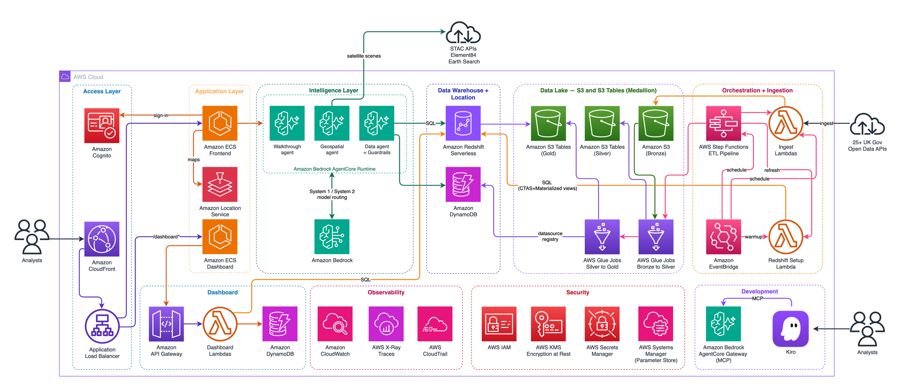
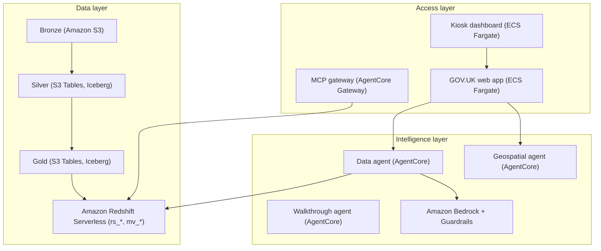
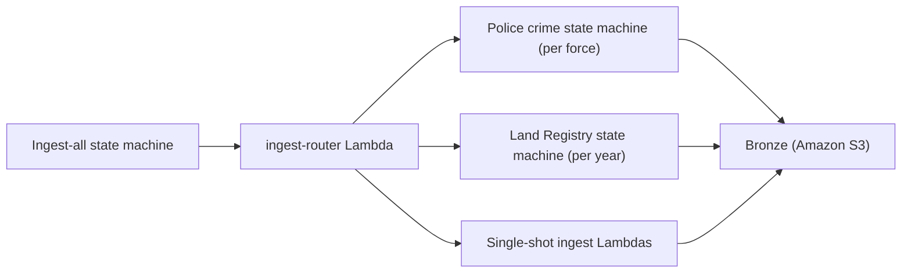
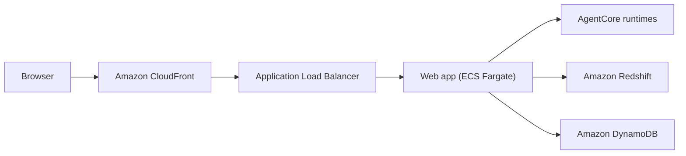

# Architecture

This guide explains how the platform works. The [README](../README.md) covers how to deploy it.

The platform brings data from 27 UK government sources into one place, at local authority level. A question in plain English gets an answer with charts and maps. It has three layers.

| Layer | What it does | Built from |
|---|---|---|
| Data | Ingests raw data, cleans it and serves it for fast query | Amazon S3, AWS Glue, Amazon S3 Tables, Amazon Redshift Serverless |
| Intelligence | Turns a question into SQL or a tool call, runs it and returns an answer | Amazon Bedrock, Bedrock AgentCore Runtime, Bedrock Guardrails |
| Access | The web app, a kiosk dashboard and an MCP gateway for other clients | Amazon ECS Fargate, Amazon CloudFront, Amazon Cognito, Bedrock AgentCore Gateway |

The editable source is `diagrams/architecture-overview.drawio`.

## Data layer

The data layer follows the medallion pattern, with three zones of increasing refinement. Amazon Redshift Serverless holds a copy of the final zone for fast queries.

### Bronze, silver and gold

| Zone | Holds | Storage |
|---|---|---|
| Bronze | Raw API responses as JSON or CSV. Nothing is changed or deleted, which keeps a rebuild from source possible at any time | Amazon S3 bucket `{prefix}-datalake-{account-id}` |
| Silver | Cleaned and typed data as Apache Iceberg tables | Amazon S3 Tables |
| Gold | A Kimball-style star schema: dimension tables and fact tables shaped for analysis | Amazon S3 Tables |

The bronze bucket is encrypted with a customer managed AWS Key Management Service (AWS KMS) key, versioned and closed to public access.

Apache Iceberg is a table format. It adds transactions and schema evolution to files in S3. Amazon S3 Tables is managed Iceberg storage. It runs compaction and snapshot expiry itself. There is no maintenance job to operate.

### Serving data with Amazon Redshift

Amazon Redshift Serverless is the SQL engine the agents query. The workgroup `{prefix}-workgroup` runs in private subnets. It starts at 8 Redshift Processing Units (RPU) and caps at 32 RPU. Admin credentials live in AWS Secrets Manager. A monthly usage limit of 200 RPU-hours logs a warning when compute runs high.

Data reaches Redshift in three hops.

1. Redshift Spectrum reads the gold S3 Tables through an external schema. The schema uses an AWS Glue resource link to the `s3tablescatalog` federated catalog.
2. A table named `rs_*` stores a typed copy of each gold table in Redshift, built with `CREATE TABLE AS SELECT`. A refresh builds each new object under a temporary name and swaps it in one transaction, so a failed refresh leaves the previous data in place.
3. Materialized views named `mv_*` join the `rs_*` objects for the queries the agents run most.

Both `rs_*` and `mv_*` are stored in Redshift. Spectrum only reads S3 Tables during the refresh step. Day-to-day agent queries never leave Redshift.

Three views carry most agent traffic.

| View | Holds |
|---|---|
| `mv_area_overview` | The latest figure for each local authority from every source. Each metric has a year or period column beside it, which tells the agent the period a figure is from |
| `mv_area_timeseries` | Each metric for each local authority over time |
| `mv_uk_summary` | National headline figures for England and Wales |

The area views filter on `geography_type = 'local_authority'`. That excludes counties and regions from the figures.

### The redshift-setup Lambda

An AWS Lambda function, `{prefix}-lambda-redshift-setup`, runs the SQL that builds the warehouse. It loads SQL files from `deploy/lambda/redshift-setup/sql/` and takes one of three actions.

| Action | What it does |
|---|---|
| `refresh` | Drops every `rs_*` and `mv_*` object, rebuilds the `rs_*` objects from Spectrum and reapplies grants |
| `gold` | Creates the external schema if it's missing, rebuilds the `mv_*` views and reapplies grants. This is the default |
| `warmup` | Runs `SELECT 1` to wake the workgroup |

The ETL state machine calls `refresh` then `gold`, which is a full rebuild.

## Ingestion and ETL

### Ingestion

An AWS Step Functions state machine, `{prefix}-sfn-ingest-all`, runs every source. It takes a list of sources, or `{"sources": ["all"]}` for all of them. A Map state runs up to 5 sources at a time. A failure in one source doesn't block the others. When a scheduled ingest finishes, it starts the ETL for the sources that landed.

The `ingest-router` Lambda maps a source name to the Lambda or state machine that fetches it. Each source Lambda runs on Graviton (arm64). Sources with a regular publication date refresh on an Amazon EventBridge schedule, listed in the [post-deploy guide](post-deploy-guide.md).

There are two ingestion patterns.

| Pattern | Used for | How it works |
|---|---|---|
| Fan-out | Police crime, Land Registry | Police crime runs one worker per police force, up to 10 at a time, to stay within the API's limit of about 15 requests a second. Land Registry runs one worker per year and skips years already in bronze |
| Single-shot | Every other source | One Lambda downloads the full dataset and writes it to bronze in one pass |

Most sources are open APIs with no key. The four Department for Work and Pensions (DWP) Stat-Xplore sources, Universal Credit, Housing Benefit, Personal Independence Payment and children in low income families, read their API key from AWS Secrets Manager (README step 7).

A DynamoDB table, `{prefix}-data-source-registry`, records every ingested source with its year range and row count. The gold Glue job writes it. The agents read it, rather than guess which years exist.

### ETL

AWS Glue runs the transforms. Glue is a serverless Apache Spark service.

Bronze to silver is one Glue job per source. Each job casts raw strings to real types and writes an Iceberg table through a shared module, `deploy/glue/lib/glue_common.py`. Time-series sources overwrite only the partitions that changed. Snapshot sources replace all their rows in one commit. New columns are added to the table. A column missing from a run is kept and written as null, not dropped.

Silver to gold is a single job, `{prefix}-glue-silver-to-gold-dimensional-model`, which builds the star schema. It builds the dimension tables first, then each fact table independently, and reports failure at the end if any table didn't build. Each table is replaced in a single commit, and a failed write leaves the previous version in place.

Crime rows are mapped to a local authority by a point-in-polygon test against Office for National Statistics (ONS) boundaries. A single police force covers many councils.

Council codes change when councils merge or are recoded. Where the source offers it, ingestion asks for current boundaries. The NOMIS sources and population arrive on April 2023 council areas, back series included. For everything else, the silver-to-gold job uses `la_code_history`, a silver table built from the ONS Code History Database.

- Recoded councils (same area, new code, such as Barnsley and Sheffield in 2025) get the current code in every gold table.
- Merged councils move onto the new council only where the figures add up: road traffic and GVA at current prices. Rates, averages and spending keep the old council's code, because they can't be summed.

The ETL state machine, `{prefix}-sfn-etl-to-gold`, runs the sequence end to end.

| Step | What it does |
|---|---|
| 1 | Checks it is the oldest running execution. A newer one ends here, because two runs would share the `rs_*__new` names and the gold Glue job; its bronze is picked up by the next run |
| 2 | Detects which bronze sources changed since the last run, plus any new source not built yet. If nothing changed, the run ends here |
| 3 | Warms up Redshift with a `SELECT 1` |
| 4 | Runs the changed bronze-to-silver Glue jobs in parallel |
| 5 | Runs the silver-to-gold job for the changed sources' tables and the dimensions |
| 6 | Calls redshift-setup with `refresh` for those tables' `rs_*` objects |
| 7 | Calls redshift-setup with `gold` |
| 8 | Fails the run if any Glue job in steps 4 or 5, or the refresh in step 6, failed |

A full run rebuilds every table and every `rs_*` object. It happens on a fresh deployment, when a new source is added, and when the state machine is started with `{"full": true}`.

Steps 6 and 7 run in order because the `mv_*` views depend on the `rs_*` objects. They also run when a Glue job failed. Step 7 also runs when step 6 failed, which keeps the area views in place. Redshift then picks up the tables that did build, and step 7 marks the run as failed. A failed bronze-to-silver job keeps its old `silver_last_processed` timestamp, and the next run queues it again.

### Writing to Amazon S3 Tables

The silver-to-gold job writes gold through the Amazon S3 Tables Iceberg REST endpoint, `s3tables.{region}.amazonaws.com/iceberg`. It uses the same `glue_common` write helpers as the silver jobs: `CREATE TABLE IF NOT EXISTS`, a full replace in one commit, and `ALTER TABLE ADD COLUMNS` when a table gains a column.

Redshift Spectrum reads gold through an AWS Glue resource link, `{prefix}_gold_s3tables`, that targets the federated catalog. Spectrum reads S3 Tables through AWS Lake Formation credential vending. That needs Lake Formation grants in every account. The Spectrum role holds DESCRIBE on the resource link and SELECT and DESCRIBE on the gold tables, with the federated catalog paths in its AWS Identity and Access Management (IAM) policy. The pipeline apply role makes those grants as a Lake Formation administrator (README step 4).

## Intelligence layer

The intelligence layer answers questions. It routes each question to a model, runs the SQL or tool the model chose, and streams the result to the browser.

### Model routing

The data agent sorts each question as simple or complex and sends it to a different Amazon Bedrock model.

- A System 1 model handles lookups, summaries and single-dataset questions. It is smaller and faster.
- A System 2 model handles cross-dataset joins and comparisons. It is larger.

A simple lookup doesn't pay the larger model's per-token price.

### Agent runtimes

Three agents run on Amazon Bedrock AgentCore Runtime. AgentCore Runtime is a serverless runtime for AI agents that isolates each session. Each agent uses the Strands Agents framework and streams events to the browser over the AG-UI protocol as Server-Sent Events (SSE).

| Agent | Folder | What it does |
|---|---|---|
| Data agent | `deploy/agent-main/` | Turns a question into read-only SQL, runs it against Redshift and returns text with charts and maps |
| Walkthrough agent | `deploy/agent-walkthrough/` | Runs guided, persona-based demonstrations |
| Geospatial agent | `deploy/agent-geospatial/` | Analyses satellite imagery over the area shown on a map |

AgentCore gives the agents session isolation, AG-UI streaming and AWS Distro for OpenTelemetry (ADOT) observability with no extra wiring.

The web app calls each runtime with a signed HTTPS request through a virtual private cloud (VPC) endpoint. Agent traffic stays on the AWS network. Runtime identifiers and container image tags are held in AWS Systems Manager Parameter Store. The build writes them.

The data agent has seven tools. They live in `deploy/agent-shared-tools/` and are copied into the container at build time.

| Tool | What it does |
|---|---|
| `run_sql` | Runs read-only SQL through the Redshift Data API, capped at 500 rows, and records which tables it touched. It rejects anything but a single SELECT on the `rs_*` tables and `mv_*` views |
| `describe_schema` | Returns table schemas, cached for an hour |
| `create_chart` | Returns a Chart.js configuration |
| `create_map` | Returns point markers for a map |
| `create_choropleth` | Returns a boundary-shaded map from a query |
| `summarise_area` | Returns a full area profile with comparisons against the local authority average |
| `get_uk_facts` | Returns the national headline figures |

### Geospatial analysis

The geospatial agent is adapted from the [Geospatial Agent on AWS](https://github.com/aws-samples/sample-geospatial-agent-on-aws) sample, which analyses Sentinel-2 imagery with Strands Agents on AgentCore Runtime. This version limits the agent to England and Wales and to two tools. Neither runs code the model wrote.

| Tool | What it does |
|---|---|
| `analyse_area(index, date)` | Computes one spectral index over the clearest scene near a date. The indices are NDVI (vegetation), NDWI (water), NDBI (built-up surfaces), NBR (burn severity) and Landsat surface temperature |
| `compare_change(index, before_date, after_date)` | Measures the change in NDVI, NDBI or NBR between two dates |

The model picks only the index, from that short list, and the dates. The area of interest is the map view the user is looking at. The page sends it. The tool refuses an area outside England and Wales, or wider than about 25 km.

Each tool searches the public Earth Search SpatioTemporal Asset Catalog (STAC) API. It picks a scene by data coverage, cloud cover and date. It widens the date window from 30 to 60 to 90 days and prefers matched seasons. It reads only the bands the index needs onto a fixed latitude and longitude grid of up to 512 pixels a side. Stored values are converted with each asset's scale and offset. Earth Search has already applied the Sentinel-2 processing baseline 04.00 offset where it flags `earthsearch:boa_offset_applied`, and the tool doesn't apply it twice.

Every result carries its provenance: scene IDs, capture dates, cloud cover, the date window used, whether the seasons match, and warnings for cloud, a season mismatch or partial scene coverage. Areas come from the area of interest, never from pixel counts. The overlay uses one diverging colour scale with a legend. The page lists the scenes it came from under the map.

The container's role can reach Bedrock, CloudWatch Logs, X-Ray, its own ECR repository and the requester-pays `usgs-landsat` bucket. Transfer from that bucket is billed to the deploying account.

The `/satellite` page uses MapLibre GL JS on the Amazon Location Service Hybrid style, served through the web app's `/map/style` proxy.

### The MCP gateway

An Amazon Bedrock AgentCore Gateway, `{prefix}-mcp-gateway`, exposes four tools over the Model Context Protocol (MCP): `query_data`, `describe_schema`, `summarise_area` and `list_datasets`. External clients such as Kiro or Amazon Quick can call them. The gateway authenticates with IAM. A caller signs each request with their own AWS credentials.

### Guardrails

Amazon Bedrock Guardrails apply content safety to the data and geospatial agents. The guardrail runs inside the model call, with no extra network hop. The walkthrough agent runs without it, because its scripted prompts trip the denied-topic rule.

| Control | Setting |
|---|---|
| Content filters | Hate, insults, sexual content, misconduct and prompt attacks at high strength. Violence at medium strength, which lets crime statistics through |
| Denied topic | Personal medical, legal and financial advice. Government data analysis is explicitly allowed |
| PII filter | Blocks AWS access keys and secret keys. Anonymises email addresses and phone numbers |

The guardrail resource is always created. `BedrockGuardrailEnabled` controls only whether the agents enforce it.

### Managing the context window

A long conversation grows the prompt, and with it cost and latency. The platform limits the context window in four places.

1. The browser strips chart, map and SQL payloads from past messages and caps each one at 3000 characters before it sends history back.
2. The agent entrypoint keeps the last 20 messages, about two or three exchanges.
3. Model routing sends simple questions to the smaller model.
4. The Strands summarising conversation manager compacts older messages if a single turn still overflows.

The system prompt carries the schema for every `rs_*` table and `mv_*` view, the national benchmarks from `mv_uk_summary`, and the year ranges from the data source registry. The model doesn't have to guess column names or periods.

## Access layer

### The web app

The web app (`deploy/webapp/`) is an Express.js server styled with GOV.UK Frontend. It runs on Amazon Elastic Container Service (Amazon ECS) with AWS Fargate. A request reaches it through Amazon CloudFront and a public Application Load Balancer.

CloudFront adds a secret header to each request. The load balancer only forwards requests that carry it. Nobody can reach the app by calling the load balancer directly. The app signs its calls to the agents, reads reference data from Amazon DynamoDB and Amazon S3, and turns a visitor's coordinates into the nearest named area with a query on the geography table through the Redshift Data API.

The `/admin` pages replay past conversations from OpenTelemetry spans and AgentCore logs. Any signed-in user can open them.

### Sign-in with Amazon Cognito

The web app signs users in against a regional Amazon Cognito user pool. The app runs the OpenID Connect authorization-code flow with Proof Key for Code Exchange (PKCE) itself. It holds the ID token in a signed, HTTP-only cookie and verifies that token on every request. The user pool stays in the deployment Region, and there is no code at the CloudFront edge.

Users are created by an administrator (README step 6). There is no self-service sign-up.

### The dashboard

A kiosk dashboard (`deploy/dashboard/`) shows how the platform is being used. It suits a wall screen at an event or an operations display. It shows usage figures such as questions asked, SQL queries run and areas explored, and coverage figures such as the number of sources, departments and local authorities.

The dashboard is its own ECS Fargate service behind the same load balancer, on the `/dashboard` path. It refreshes every 15 seconds. It releases on a different cycle from the web app, which is why it's a separate container. The dashboard accepts the web app's sign-in cookie and sends anyone without one to the web app's login.

## Observability

Each agent runtime auto-instruments with AWS Distro for OpenTelemetry. Traces go to AWS X-Ray and logs go to Amazon CloudWatch through OpenTelemetry Protocol (OTLP) endpoints. Environment variables on the runtime set them up. The CloudWatch GenAI observability dashboard shows token counts, the span tree, tool calls and latency for each session.

The web app has an ADOT collector sidecar that sends its AWS SDK calls to X-Ray. CloudTrail records S3 data events on the lake for audit. Amazon Athena can query them.

## Security

| Area | How |
|---|---|
| Encryption | Separate AWS KMS keys protect the data lake, the pipeline buckets and the Terraform state. Every bucket uses server-side encryption, enforces TLS 1.2 or higher and blocks public access |
| Least-privilege IAM | Each source Lambda can write only under the bronze prefix. The Glue role reads bronze and writes silver and gold. The Spectrum role reads gold through Lake Formation grants. Each agent role gets only the Bedrock, Redshift, DynamoDB and S3 access it needs |
| Private networking | Redshift, the agent runtimes and the gateway tool Lambdas sit in private subnets. The data and walkthrough agents and the gateway tool Lambdas reach AWS through VPC endpoints only, with no route to the internet. The geospatial agent can reach the internet over HTTPS for the public satellite catalogue and imagery. The web app is reachable only through CloudFront and the load balancer |
| Session binding | Each agent session id carries a signature over the signed-in user, checked before any invoke or cancel call. One user can't continue or stop another user's conversation |

## CI/CD

The [README](../README.md) covers the deployment steps. Two design points are worth knowing.

Bootstrap's Terraform state lives on the machine that applied it. Only that machine can change or remove the pipeline, and its `terraform destroy` has to run locally because a pipeline can't delete the role it runs as.

The deploy pipeline applies the platform twice. The agent runtimes reference container images that don't exist on a fresh account. The first apply is allowed to fail, the build stage pushes the images, and the second apply completes against them. The Deploy stage then refreshes any Redshift object whose SQL changed in the commit, so a SQL change takes effect with the deploy.

## Future considerations

The ETL runs one Glue job per source, ordered by the ETL state machine. Spark Declarative Pipelines in AWS Glue 6.0 declare the target datasets in SQL or Python. Glue then works out the dependencies and run order. Replacing the per-source jobs and the state machine with one declarative pipeline could simplify the ETL. It would re-architect the transform layer. Treat it as its own piece of work rather than a version upgrade.
